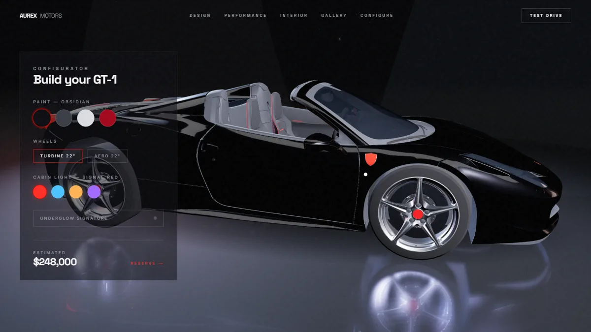

# AUREX MOTORS — GT-1

[English](README.md)

Site-experiência cinematográfico para uma fabricante **fictícia** de carros
elétricos de luxo. A ideia: entrar num comercial, não num site.

> **Tipo:** conceito / peça de portfólio (marca fictícia). AUREX MOTORS não existe e não tem vínculo com a Ferrari nem com qualquer montadora.
> **Demo:** https://aurex-motors-ecru.vercel.app


O carro (AUREX GT-1) usa o modelo 3D do Ferrari 458 Italia que acompanha os
exemplos do three.js (`public/models/ferrari-opt.glb`, comprimido com Draco),
com os materiais trocados em código para a identidade AUREX. O ambiente de
estúdio é gerado com Lightformers, sem HDR baixado.

## Funcionalidades

- Narrativa por rolagem em cenas (hero, filme, design, performance, interior,
  galeria, configurador, final), com câmera roteirizada em React Three Fiber.
- Configurador em tempo real: pintura, rodas, cor da luz de cabine e
  underglow, com preço estimado (valor fictício).
- Galeria com canvas próprio (4 carros); o canvas principal pausa enquanto ela
  está visível.
- Pós-processamento (Bloom/Vignette), cursor customizado, loader e rolagem
  suave com Lenis (desativada em telas touch).
- Botão "Schedule a Test Drive" abre um `mailto:` para um endereço de exemplo
  (`reserve@aurexmotors.example`, domínio reservado; não envia nada a ninguém).



## Stack

Next.js 15 (App Router) · React 19 · TypeScript · Tailwind CSS v4 · GSAP +
ScrollTrigger · Lenis · React Three Fiber + drei · @react-three/postprocessing
(Bloom/Vignette) · Framer Motion · three.js

## Rodar localmente

Pré-requisitos: Node.js 20 ou superior (verificado com Node 22) e npm.

```bash
npm ci
npm run dev        # http://localhost:3000
```

Não há variáveis de ambiente. A URL pública usada nos metadados (Open Graph)
está fixa em `src/app/layout.tsx` (`SITE_URL`).

### Scripts

| Script | O que faz |
| --- | --- |
| `npm run dev` | servidor de desenvolvimento |
| `npm run build` | build de produção |
| `npm run start` | serve o build de produção |
| `npm run lint` | ESLint (o decoder Draco em `public/draco/` é ignorado por ser código de terceiros) |

As devDependencies `@gltf-transform/*` e `draco3dgltf` foram usadas para
otimizar o GLB; não há script versionado para isso.

## Estrutura

```
src/app/               layout, página única e estilos globais
src/components/        nav, loader, cursor, rolagem suave, rastreador de cenas
src/components/scene/  canvas 3D, rig de câmera, carro e palco
src/components/sections/  hero, história, galeria, configurador, final
src/lib/               roteiro de cenas (scenes.ts) e estado compartilhado (world.ts)
public/models/         ferrari-opt.glb (Draco)
public/draco/          decoder Draco (WASM/JS)
docs/screenshots/      capturas usadas neste README
```

## Arquitetura

- `src/lib/world.ts` — estado mutável compartilhado (scroll, ponteiro,
  configuração do carro). Lido em `useFrame`, nunca via React state:
  scroll não re-renderiza nada.
- `src/lib/scenes.ts` — o "roteiro do filme": keyframes de câmera, rotação
  do carro e intensidades de luz por cena.
- `src/components/scene-tracker.tsx` — um ScrollTrigger por `[data-scene]`
  escreve `(cena, progresso)` no world; espelha a cena ativa em
  `<html data-scene>` para o CSS (letterbox, dimming do canvas).
- `src/components/scene/camera-rig.tsx` — amostra o roteiro e faz damping
  exponencial: cortes viram movimentos de dolly. Parallax de mouse por cima.
- `src/components/scene/car.tsx`: carrega o GLB (decoder Draco em
  `public/draco/`), clona a cena por instância e religa os materiais: pintura
  configurável, detalhes vermelhos e assinatura de luz emissiva.
- Configurador escreve direto em `world.config`; o carro faz lerp dos
  materiais a cada frame (troca "líquida", zero re-render 3D).
- Galeria tem canvas próprio (4 carros, câmera pan) — o canvas principal
  pausa (`frameloop="never"`) enquanto isso.

## Gotchas documentados

- GSAP interpreta `translateY(115%)` inline como `y` em px — anime `y`,
  não `yPercent`, ou nada se move.
- Tailwind v4: CSS sem `@layer` vence QUALQUER utility (`md:hidden` não
  esconde um `.btn-primary` não-layered).
- Triggers de cena precisam de `end: "bottom top"` — com `bottom bottom`
  há zona morta de 100vh entre seções e o canvas congela/esconde na hora
  errada.
- Emissivos `toneMapped={false}` + Environment forte + Bloom = supernova;
  o vidro precisa de `envMapIntensity` baixo.
- Lenis desativado em `pointer: coarse` (medidas do ScrollTrigger quebram
  em touch; scroll nativo é melhor lá).

## Limitações

- Exige WebGL; a experiência é pesada (First Load JS da página ≈ 577 kB, mais o
  GLB) e depende de GPU razoável.
- Conteúdo, especificações e preços são fictícios; não há backend, reserva
  ou formulário real.
- Sem testes automatizados; a CI roda lint, checagem de tipos e build.

## Créditos

- Modelo 3D: Ferrari 458 Italia, de [vicent091036](https://sketchfab.com/models/57bf6cc56931426e87494f554df1dab6),
  distribuído nos exemplos do [three.js](https://github.com/mrdoob/three.js)
  (`examples/models/gltf/ferrari.glb`), aqui reotimizado. O modelo segue a
  licença do autor original (não a licença MIT do three.js): confira-a antes
  de qualquer uso comercial. "Ferrari" e o design do 458 Italia pertencem aos
  seus titulares; este projeto não tem relação com a Ferrari.
- Decoder Draco em `public/draco/`: [Google Draco](https://github.com/google/draco)
  (Apache-2.0), como distribuído pelo three.js.
- Fontes Space Grotesk e Inter via `next/font/google`.

## Segurança

Veja [SECURITY.md](SECURITY.md).

## Licença

Ainda não há licença definida; todos os direitos reservados ao autor. Os
itens de terceiros acima seguem as respectivas licenças.
